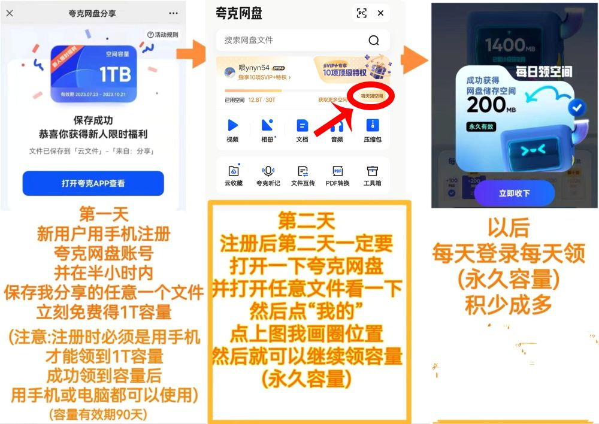

# 夸克网盘 （免费获取1TB空间）

### 今天教大家如何获取夸克网盘1TB空间（有效期3个月，到期后可重新获取）（注意，只有手机端手机号登录可以获取，电脑端、QQ一键登录、微信一键登录后转存文件的不生效）

### 详细步骤：

#### 新用户教程（手机号未注册过夸克账号的）

1. 手机端下载好夸克网盘App，并且必须使用手机号登录

2. 复制资源口令   **/~21ff3bNyAG~:/**   ，然后打开夸克App即可识别，然后转存即可。

   或者复制以下这段完整链接：

   **我用夸克网盘给你分享了「免费扩容 1TB...会员教程」，点击链接或复制整段内容，打开「夸克APP」即可获取。**
   **亝闭已一词并闭侬轶袄符忛**
   **/~21ff3bNyAG~:/**

3. **转存成功后**，点进转存的文件里浏览其中的图片30秒到2分钟，以通过活跃度检测。

4. **扩容次日0:00–24:00内**，点进转存的文件里浏览其中的图片30秒到2分钟，以通过活跃度检测。

5. 之后就拥有1TB空间权益了

#### 老用户教程（手机号注册过夸克账号的）

该方法适用于老用户，核心是让原手机号在系统中被识别为“新注册账号”。需先备份资料，再执行解绑与验证码重登操作，切断历史账号绑定痕迹。

1. 进入夸克App「我的-设置-账号与安全-手机号码」，点击**「解绑手机号」**并确认退出登录。
2. 若未自动退出，手动进入「账号与安全」选择**「退出登录」**。
3. 返回登录界面，使用刚刚解绑的同一手机号，通过**短信验证码方式重新登录**，严禁使用第三方快捷登录。
4. 登录成功后，立即访问上述专属链接，点击**「保存到网盘」**，等待系统提示“新用户福利已发放”。
5. 前往用户中心刷新存储空间，确认是否更新为**1024GB**；若未生效，说明该号码已被系统标记为不可洗白，需更换新手机号重试。

- 界面：

   

  ​
